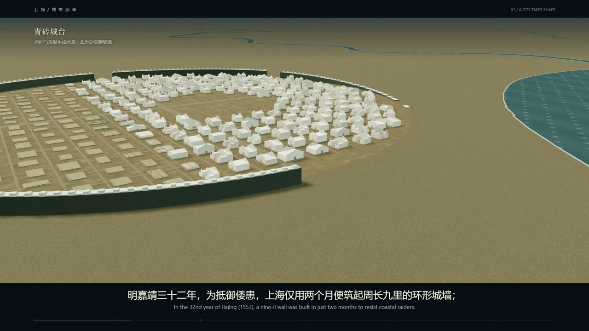

# 城市纪录片制作 Skill

给 Codex 一个城市、一个想讲清楚的变化和片长。它负责查资料、写旁白、接入可用配音、找或做画面，最后交一条片和双语字幕。下面用《上海 · 城市纪事》的老城厢段落走一遍。



[公众号教程：四步和每步产物](article/article.md) · [HTML 版](article/shanghai-city-documentary.html) · [上海样片 MP4](article/demo/film.mp4) · [上海案例](references/shanghai.md)

## 在 Codex 里用

在你的项目目录打开终端，运行下面这行，再打开这个项目的 Codex 会话：

```sh
git clone https://github.com/dailyoozoo/city-documentary-skill.git .agents/skills/city-documentary-skill
```

对 Codex 说：

> 用 `$city-documentary-skill` 做一条 30 秒的城市纪录片，讲【城市】的【变化】。你去查资料，先给我编号旁白和出处；稿子定了再配音、找素材、做分镜和出片。

真实项目里，联网检索、配音和图像生成分别由环境提供。可用的现有录音可以直接接入，照片、地图、视频也可以用自己已有的素材。Skill 附的是流程、剪辑脚本和能离线复跑的上海案例。

## 先跑通上海样片

从**仓库根目录**运行。需要 Python 3.11+ 和 PATH 上的 FFmpeg（含 `ffprobe`、`libx264`）。上海样片使用已带字幕的成片画面，不需要配音凭证或额外的字体。

```sh
python -m pip install -r requirements.txt
python -X utf8 scripts/build.py --example --out build/shanghai-demo
python -X utf8 scripts/serve.py build/shanghai-demo --port 8765
```

打开本机 `http://127.0.0.1:8765/review.html`，可以播放、按段跳转，并下载 MP4 和独立字幕。`build/shanghai-demo` 必须是新目录，重新出片时换一个目录名。服务结束时按 `Ctrl+C`。

输入都在 [`article/demo/`](article/demo/)：三句[旁白](article/demo/narration.md)、[配音时码](article/demo/timing.tsv)、[分镜](article/demo/storyboard.md)、[来源表](article/demo/sources.tsv)、`voice.wav`、`picture.mp4` 和 [`project.json`](article/demo/project.json)。公开样片来自实际上海成片，用原项目的干声旁白，省去原片配乐；三维画面是形制示意。命令复跑的是这段的剪辑和出片，不需要原工程，也不从零重建全部上海模型。

## 换成你自己的城市

让 Codex 把旁白、时码、素材和 `project.json` 写进 `work/city-film/`。素材路径相对 `project.json`，例如 `media/shot-01.mp4`。换画面、字幕或时长前，先读 [输入字段和操作说明](references/workflow.md)。

从**用户项目根目录**运行，或把这些步骤交给同一个 Codex 对话：

```sh
python -m pip install -r .agents/skills/city-documentary-skill/requirements.txt
python -X utf8 .agents/skills/city-documentary-skill/scripts/build.py --project work/city-film/project.json --narration work/city-film/voice.wav --out build/my-city
python -X utf8 .agents/skills/city-documentary-skill/scripts/serve.py build/my-city --port 8765
```

新图或视频需要加字幕时使用简体中文字体；没有检测到时加 `--font <字体文件路径>`。缺旁白的草稿可以省略 `--narration`。素材和示例范围见[使用说明](RIGHTS.md)。
