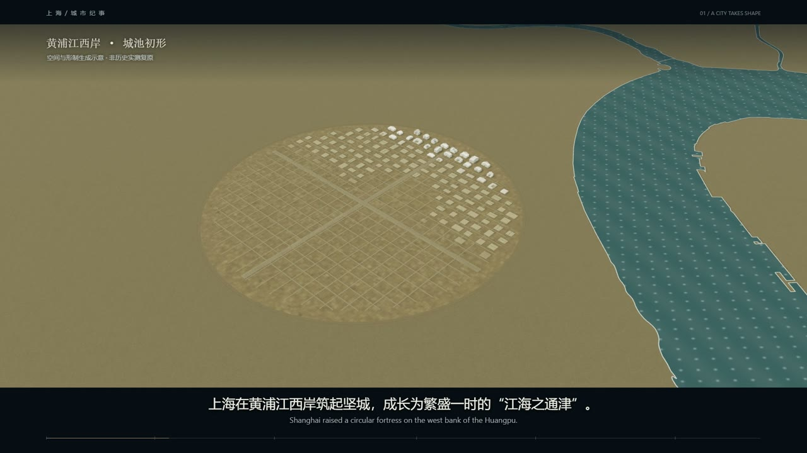
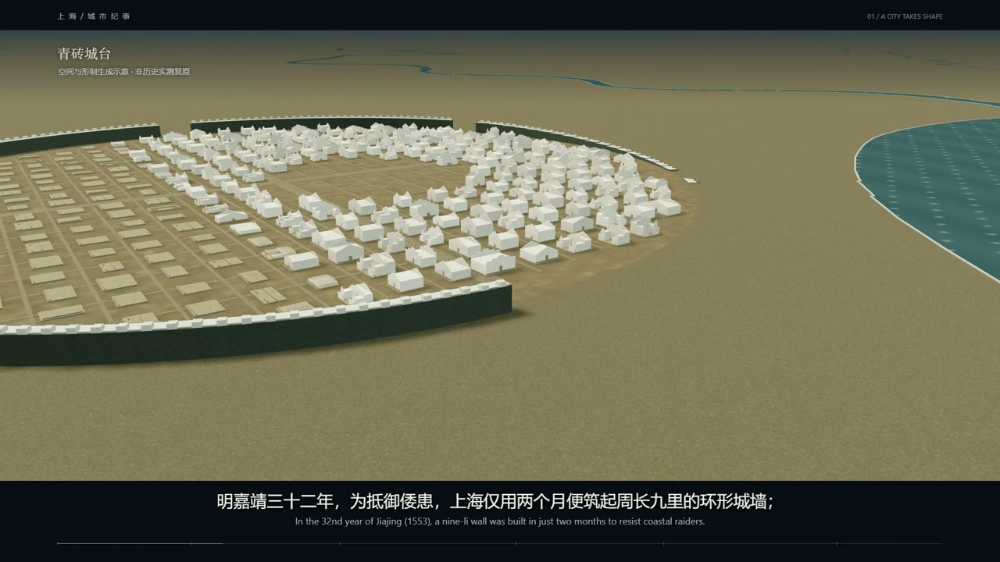
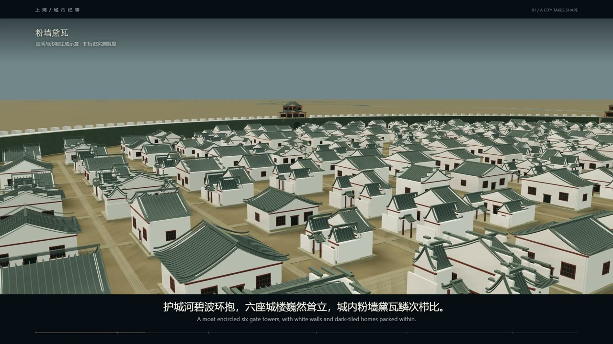

# 用一个 Skill 做城市纪录片：拿上海老城厢走一遍

这篇用《上海 · 城市纪事》的老城厢段落演示。你只要给 Codex 一个城市、一件想讲清楚的事，再按下面四步发消息。每一步的产物都放在正文里。

在你的项目目录打开终端，运行下面这行。重新打开这个项目的 Codex 会话，四步都在同一个对话里做。

```sh
git clone https://github.com/dailyoozoo/city-documentary-skill.git .agents/skills/city-documentary-skill
```

## 01｜写旁白

**你怎么做：** 把城市、主题、时长填进去，发给 Codex：

> 用 $city-documentary-skill 做一条约 30 秒的短片，讲【城市】的【变化】。你查资料，先给我带编号的旁白，每个关键事实附出处。

**产物：一份可以直接念的旁白稿，一张来源表。** 先核对年份、地名和不好念的字，再定稿。上海样片实际用了这三句：

01｜上海在黄浦江西岸筑起坚城，成长为繁盛一时的“江海之通津”。

02｜明嘉靖三十二年，为抵御倭患，上海仅用两个月便筑起周长九里的环形城墙；

03｜护城河碧波环抱，六座城楼巍然耸立，城内粉墙黛瓦鳞次栉比。

出处示例：筑城年份和护城河查[上海师范大学的老城厢研究](https://www.shnu.edu.cn/57/f0/c26244a808944/page.htm)；「九里」参照[豫园官网](https://www.yugarden.com.cn/page/ArticleView/history-scenery.html)。 [查看完整来源表](demo/sources.tsv)

## 02｜先配音

**你怎么做：** 确认稿子后，接着发：

> 用已接入的配音工具念定稿，或者用我提供的录音。给我一条干净人声，再标出每句在哪一秒开始、在哪一秒结束。

**产物：一条单独的旁白音频，一张逐句时间表。** 音频要先听一遍，尤其是专名和数字。下面是这段上海样片实际使用的旁白和剪辑时码，后续按它排画面。

<audio controls preload="metadata" src="demo/voice.wav"></audio>

[下载旁白 WAV](demo/voice.wav) · [下载时间表](demo/timing.tsv)

| 句子 | 开始（秒） | 结束（秒） |
| --- | --- | --- |
| 01 | 0.000 | 7.750 |
| 02 | 7.750 | 15.792 |
| 03 | 15.792 | 23.250 |

## 03｜找画面、做分镜

**你怎么做：** 接着发：

> 按这张时间表给每句配画面。你去网上找授权可用的照片、地图或视频，记录出处和许可；找不到合适的，就做一张图或一段三维示意。先把分镜和对应画面发我。

**产物：一份分镜，和每段要用的画面。** 找素材这一步由 Agent 做。上海这里用的是三维示意：利用同一条河和同一圈城墙，先定方向，再把镜头带进城里。下面三张直接截自最终成片。



01｜0.000–7.750 秒：先交代方位。俯看黄浦江与城址，让观众知道老城在河的哪一边。



02｜7.750–15.792 秒：再让城墙出现。沿着城址的轮廓让城墙合拢，黄浦江留在画面里作参照。



03｜15.792–23.250 秒：最后进入城内。从护城河降到屋顶高度，看到城里成片的民居。

[打开完整分镜](demo/storyboard.md)

## 04｜导出视频

**你怎么做：** 看过分镜后，接着发：

> 按分镜把画面剪到旁白上，加双语字幕。检查声音、字幕和画面能不能对上，导出 MP4、独立字幕和观看页。

**产物：一条能播放的 MP4、一份双语字幕、一个能按段跳转的观看页。** 下面这段长 23.25 秒，取自《上海 · 城市纪事》的最终画面，用原项目同一段旁白，公开演示省去了配乐。

<video controls playsinline preload="metadata" poster="demo/final-wall.jpg" src="demo/film.mp4"></video>

[下载样片 MP4](demo/film.mp4) · [下载字幕 SRT](demo/subtitles.srt) · [打开观看页](demo/review.html)

想自己跑一次？GitHub 里带了这段的画面、旁白和工程。按 README 的「先跑通上海样片」运行，就能重新导出视频、字幕和观看页。

解压后打开 HTML，就能播放音视频和查看附件。发公众号时，在后台上传样片和配图；如需单独放旁白，按后台要求上传音频。

**GitHub｜城市纪录片制作 Skill**

[https://github.com/dailyoozoo/city-documentary-skill](https://github.com/dailyoozoo/city-documentary-skill)
