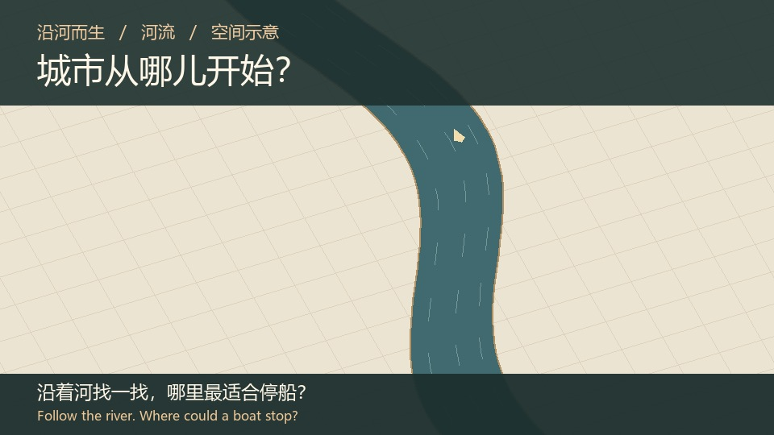
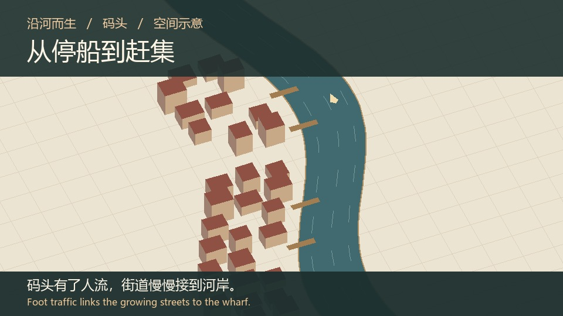
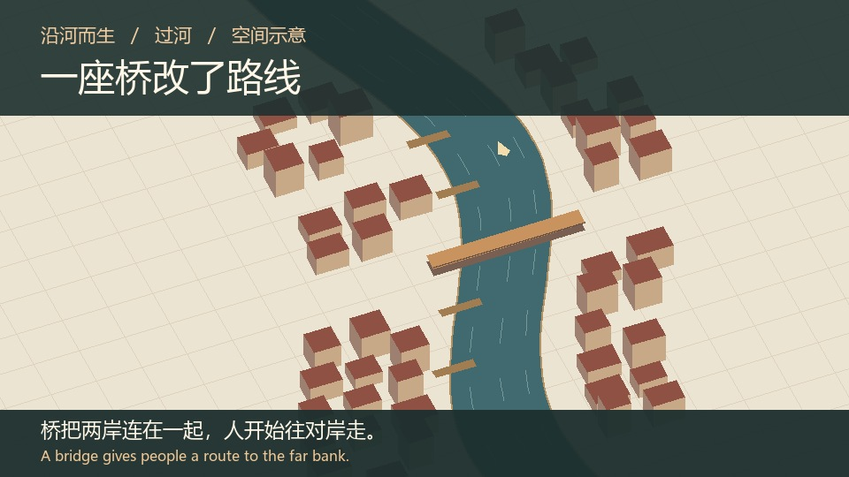
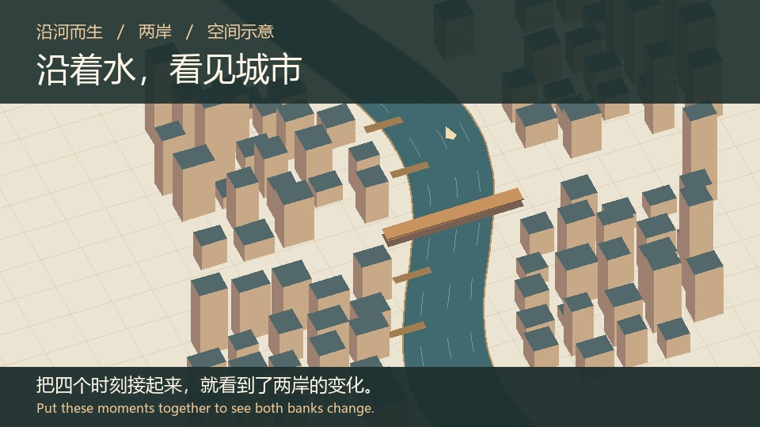

# 怎么做一部城市纪录片？先用四个镜头拍明白一座桥

> 一份从选题、找资料到出片的实操教程。照着做，你可以先跑出一条 24 秒样片，再把它改成自己的城市故事。

想拍家乡，可以先挑一个每天经过的地方：一座桥、一个老码头，或者一段改过道的河。给它提一个问题。比如：**桥建成前后，人们过河的路线有什么变化？**

接下来只做四件事：让观众认出两岸，看到原来的过河路线，找到桥的位置，最后看清新路线。你就有了一条能独立播放的短片，也有了一套可以重复使用的方法。下面用公开仓库里的虚构河城练手；要拍真实城市，再把地点和证据换成自己的。

## 01｜先找能回答问题的资料

先画一张草图，标出两岸、旧渡口和桥。然后带着草图找资料：地方志或工程档案能帮你确认桥何时通车，一张旧地图可能标出渡口在哪，今天自己拍的照片则能交代现在的桥头是什么样。**要证明路线发生了变化，最好各找一份能说明变化前后的资料。** 找不到渡运停办的记录，就不要写「通车当天渡口就消失了」；写「从此多了一条过河路线」，只需要证实桥开通和路线的位置。

建议存两张表，仓库有现成的 `assets/source-register.tsv` 模板可以改：

- **事实表**：准备说什么、出处链接或页码、资料年代、它能证明到哪一步。
- **素材表**：画面用哪一个文件、谁拍的、拍于何时、能否公开使用、需要怎么署名。

例如，图书馆收藏的一张旧渡口照片可以帮你查证位置；能不能把照片放进片子，要另看使用条件。手头只有旧地图和自己的实拍，也够开工：从地图上取位置，用自己画的路线图交代以前的走法，标注「示意图」。

## 02｜写四句旁白，再把每句配成一个镜头

下表是围绕「怎么过河」写的一版可改分镜，共 24 秒。台词和地形都用于练习。下载后的原始示例用同样的四段结构，画面和旁白略有不同。

| 时间 | 旁白 | 画面与素材 |
| --- | --- | --- |
| 0–6 秒 | 先认一下路：这条河把镇子分成了两岸。 | 俯视简图，标出河、两岸和北向。用自绘地图。 |
| 6–12 秒 | 以前要去对岸，得先沿河走到渡口。 | 保持地图方向，点亮去渡口的路线。用经核对的旧地图作参考。 |
| 12–18 秒 | 桥建在这里，两岸多了一条过河的路。 | 地图上先标桥位，再切桥头照片。用有使用权的实拍。 |
| 18–24 秒 | 把两条路线画在一起，变化就看得出来了。 | 回到同一张底图，用两种线型标注「原渡运路线」「桥上路线」。 |

写完就读一遍。若第二句说了渡口的位置、集市的起源，还讲了船怎么造，先删到只剩本段要用的信息。英文字幕也保留这一句的重点，读得完比逐字对应更有用。



## 03｜先用地图和照片把画面剪通

剪这四个镜头时，最容易断的是「地图切到实景」。试着在地图上先圈出桥头，再切到能看见同一侧河岸的照片；下一镜回地图时，继续保留这个桥位。可以暂时关掉声音，看看自己能否只凭画面指出「人从哪边走、在哪里过河」。如果看不出来，先调地图方向、取景和标记。

画面可以分三档做：**一张地图加一根路线**，够说明位置；**加旧照片或今天的实拍**，够对照变化；**加三维场景**，适合讲平面不容易说明的空间关系，比如建筑怎样挡住河岸、坡道怎样接到桥面。仓库的 `river`、`wharf`、`bridge`、`city` 是固定的程序化示意；真要展示自己的地形，先换成自绘地图和自己的照片。等镜头顺了，再把最能受益的一段升级成三维，做法见第 06 步。

上海项目里，「1292 年设县」用的是带年份的节点图。手里若只有后世城墙的材料，可以先用节点说明设县，等讲到城墙所属年代，再给它自己的镜头。你遇到缺图的年代，也可以这样处理。



## 04｜用真实录音给镜头和字幕定时

拿手机或电脑先录一遍，导出一条干净的 `voice.wav`。打开能看到波形的剪辑软件，从录音开头标出四段开始的时间，再标出最后一段结束后要留的停顿。相邻时间相减，就是要填入分镜的 `seconds`。比如第二段从 5.8 秒开始、第三段从 11.6 秒开始，第二个镜头就填 `5.8` 秒。没录音时先拿 6 秒一镜看节奏，录好以后再换成实测时间。

同一个镜头的 `zh` 放中文旁白，`en` 放该句英文字幕。录音、音乐和字幕分开存，以后修一个地名，可以重录这一句，再从前后停顿接进去。先试听干声，确认日期、地名和数字，再加音乐。这里的构建脚本按你填的时间出片，**句界需要你自己标**。

## 05｜跑出样片，再亲手换一张图

先装 Python 3.11 或更新版本、FFmpeg（要能运行 `ffmpeg`、`ffprobe`，并含 `libx264`）和简体中文字体。下载文末仓库，解压；在能看到 `requirements.txt` 的目录里打开终端，依次执行：

```sh
python -m pip install -r requirements.txt
python -X utf8 scripts/build.py --out build/river-town
python -X utf8 scripts/serve.py build/river-town --port 8765
```

在浏览器打开 [http://127.0.0.1:8765/review.html](http://127.0.0.1:8765/review.html)。你会看到 24 秒、四个跳转点的样片。打开 `build/river-town` 也能直接找到 `film.mp4`、双语 SRT/VTT 字幕和 `verification.json` 技术检查报告。示例默认静音，不需要配音 API。看完按 `Ctrl+C` 停止预览服务。

**第一轮练习，只替换第三镜的画面和台词。** 在仓库里建一个 `my-city` 文件夹，把 `assets/river-town/project.json` 复制进去，再放一张你有权使用的桥头照片，命名为 `bridge.jpg`。用下面的内容替换 `shots` 里的第三项，保留各项之间的逗号。若想先验证流程，可复制 `article/still-bridge.jpg` 并改名为 `bridge.jpg`；这时把 `source` 改为「仓库原创虚构河城示例」，把 `visual_role` 改为「示意图」。

```json
{
  "id": "bridge",
  "chapter": "过河",
  "kind": "image",
  "seconds": 6,
  "title": "今天的桥头",
  "zh": "桥建在这里，两岸多了一条过河的路。",
  "en": "The bridge adds a new way across the river.",
  "image": "bridge.jpg",
  "source": "把这里换成照片作者、拍摄时间和出处",
  "visual_role": "现代参照"
}
```

```sh
python -X utf8 scripts/build.py --project my-city/project.json --out build/my-city-v1
```

打开 `build/my-city-v1/film.mp4`，跳到第 12 秒，看桥头照片和新字幕是不是一起出现了。接着把四个镜头都换成你自己的画面和台词。入门脚本的 `image` 每镜接收一张静态图；如果一个镜头里想先看地图、再切照片，可以拆成两个条目，各填时长，并让 `id` 保持唯一。有旁白之后，把 `voice.wav` 放到 `my-city`，根据录音修改四个 `seconds`，再跑一版：

```sh
python -X utf8 scripts/build.py --project my-city/project.json --narration my-city/voice.wav --out build/my-city-v2
```

每次给 `--out` 一个尚不存在的目录，方便留着上一版对照。录音比时间轴长，脚本会停下来提示调整。若系统找不到合适的中文字体，在构建命令末尾加 `--font "字体文件路径"`。预览自己的版本时，把 `serve.py` 命令里的目录换成对应输出目录。



## 06｜想做出电影感，先加一个有用的三维镜头

挑一个平面图解释不清的问题。比如「人从街巷出来，怎么绕上高过河岸的桥面？」先在 Three.js 里铺河和两岸，按核对过的方位摆道路、桥台和桥面；街区先用简单方块。先用一个固定俯视角检查路线通不通，再设两个相机位置：沿用上一镜的俯视方向开场，慢慢降低到能看出引桥坡度的角度。桥头在两镜里都尽量留在画面同一侧，观众才跟得上。

导出之前，给镜头记好「起止时间、相机起点、相机终点、镜头看哪里」。例如这个 6 秒镜头按 24 帧每秒，应取 144 帧：用帧号除以 24 得到场景时刻，浏览器逐帧取图，再用 FFmpeg 合成。先出一段低分辨率预览，确认相机没有穿模、字幕没盖住桥头，再出成片。入门脚本走的是轻量图解流程；这个浏览器渲染的做法可以对照仓库里的 [上海案例索引](https://github.com/dailyoozoo/city-documentary-skill/blob/main/references/shanghai.md)，从「老城程序场景」「时间轴」「原浏览器渲染器」三个入口看实现。没有测绘或对应年代的证据时，画面上标注「空间示意」。

## 07｜先验 24 秒，再按同样方法扩成长片

拿手机正常速度从头播一遍。看字幕是否来得及读，听「桥名」「年份」「地名」有没有读错。再请一个没听过故事的人看完，用一句话说出路线变在哪儿。他如果分不清两岸，回第一个镜头补方位；如果看不出变化，回最后一个镜头把两条路线一起亮出来。`verification.json` 可以检查解码和规格，故事是否看得懂、旁白是否听得清，要靠播放来验。

四个镜头讲通后，再加第二小节，比如「桥通车后，街道怎么接到桥头？」按同一套步骤补证据、分镜和录音。先给每小节的镜头留一个稳定的编号，合片时再检查章节衔接和字幕，最后交付成片、观看页、字幕及来源表。



## 把这套做法装进 Codex

如果想让 Codex 协助，在自己的项目目录运行下面的命令，再重新打开项目会话：

```sh
git clone https://github.com/dailyoozoo/city-documentary-skill.git .agents/skills/city-documentary-skill
```

可以从这个提示词开始：

> 用 `$city-documentary-skill` 帮我做一段 24 秒城市纪录片，问题是「这座桥怎样改变过河路线」。我会提供地方志链接、旧地图和实拍照片。先列“事实、出处、能证明什么”和“画面、年代、许可”两张表，再给我四个镜头的中文旁白、英文字幕和预计秒数。缺证据的地方标待核，先用自绘示意图完成静音样片。等我提供录音和四段句界，再更新 `seconds` 并导出成片、字幕和观看页。

仓库里有可以直接跑的示例、可复制的分镜与来源表，还有上海项目的关键制作源码可供进阶参考。第一次用，建议先跑通原样片，再完成上面的换图练习。

**GitHub｜城市纪录片制作 Skill**

[https://github.com/dailyoozoo/city-documentary-skill](https://github.com/dailyoozoo/city-documentary-skill)
